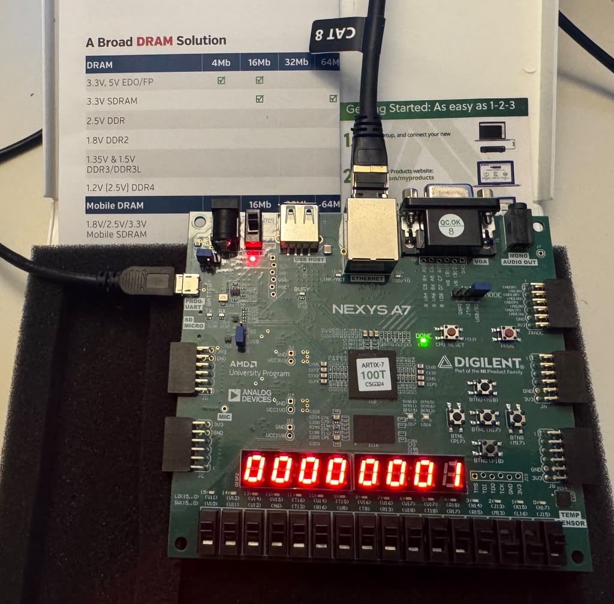

# ITCH FPGA Hardware Market-Data Parser


SystemVerilog · cocotb · Python · Vivado · [github.com/tmarhguy/itch-hw](https://github.com/tmarhguy/itch-hw)

---

### Why this exists

In conversations with business friends — especially Wharton students — NASDAQ comes up a lot. The argument usually starts with the **open book**: the visible bids and asks. The goal is simple: make the fastest, best decision to buy at the lowest price or sell at the highest. I love challenges :)

### Why not a CPU?

From a computer engineering perspective, a conventional Von Neumann CPU is a poor fit for that kind of rapid decision-making. (The elephant in the room: the **Von Neumann bottleneck** — fetch, decode, move data through memory, repeat.)

To skip the OS and avoid unnecessary data movement, you want a **hardened logic block** that makes those decisions and tells the CPU what it did. It has to be accurate and deterministic. Fast. Blazing. Otherwise you lose.

### Why an FPGA?

**FPGAs solve this.** Reconfigurable logic sits close to the wire — no general-purpose fetch-decode loop in the hot path.

You can't tape out a new chip every time the logic needs to change. FPGAs sit in the middle: **reconfigurability** when you're still iterating, **hardened logic** on the paths that need to be fast and deterministic. Flash a new bitstream, test, repeat — without a fab run.

<p align="center">
  
</p>

<p align="center"><em>Nexys A7-100T · Artix-7 100T · Ethernet ingress into the ITCH core</em></p>

Engineering, as I read it, is about applying what you know to solve a problem in a domain — and it has no real limit on *which* domain that is. Finance, networks, silicon: same toolkit, different battlefield.

### What I'm building here

In this repo I'm exploring what it looks like to feed an FPGA market data over Ethernet, watch real decision-making happen in hardware, and — ambitiously — move toward seeing trades happen, one step at a time. RTL in **SystemVerilog**, synthesized and programmed with **Vivado** — that's the toolchain for this board.

---

## Contents

- [What this repo does](#what-this-repo-does)
- [What is ITCH hardware?](#what-is-itch-hardware)
- [The loop](#the-loop)
- [Platform](#platform)
- [Run it](#run-it)
- [Docs & notes](#docs--notes)

---

## What this repo does

NASDAQ's **ITCH** feed is a binary stream of Add, Execute, and Cancel messages. Exchanges don't wait for your software stack. This project is the **hardware** column from the table above — implemented on a Nexys A7-100T:

- Bytes arrive over Ethernet (UDP, Mold-wrapped ITCH)
- A streaming parser turns them into structured order events
- A dual-sided order book updates and recomputes **best bid / best offer (BBO)**
- LEDs and the 7-segment display show you the answer on silicon — not buried in a log file

Simulation comes first: cocotb replays millions of synthetic ITCH events against a Python golden model. Zero BBO mismatches before the bitstream gets trusted.

---

## What is ITCH hardware?

**ITCH** is NASDAQ's wire format for market data — a stream of binary messages (Add order, Execute, Cancel, …) that describes how the open book changes in real time.

Most people parse ITCH in **software**: the NIC DMAs into kernel memory, the OS wakes your process, you decode bytes in a loop, and you keep the book in regular RAM. It works. It's also a long chain — drivers, syscalls, cache misses — between the cable and your answer.

**ITCH hardware** means that same job is done in **silicon logic** instead:

| | Software ITCH | ITCH hardware (this repo) |
|---|---|---|
| **Bytes arrive** | Kernel buffer → your process | Ethernet PHY → FPGA fabric |
| **Who parses** | CPU running a program | Dedicated FSM in SystemVerilog |
| **Order book** | Structs in host RAM | Dual BRAM tables on-chip |
| **Best bid / offer** | Function calls, heap lookups | Fixed logic — known clock cycles |
| **Hot path** | OS, scheduler, memory bus | No OS — wire straight to the book |

Same protocol. Same messages. Different place the work happens — and that's the whole point.

---

## The loop

Every trading system runs the same story. Here, the whole arc lives on one FPGA — no host in the hot path.

```
  MARKET DATA IN          DECISION              OUT
  ─────────────         ──────────            ───
  Ethernet / UDP   →    Parse ITCH      →    BBO + LEDs
  Mold-wrapped bytes    Order book           7-segment
                        Best bid / offer
```

**1. Market data in.** Live traffic hits the on-board **LAN8720** PHY. RMII RX, UDP filter, Mold unwrap — ITCH bytes reach the parser without a CPU `memcpy`.

**2. Decision.** An **8-bit streaming FSM** decodes each message into symbol, side, price, quantity, and nanosecond timestamp. A dual-sided **512-slot BRAM book** applies the event and recomputes BBO — **under 10 clock cycles** on the Add path at 100 MHz.

**3. Out.** **LED15** = link up. **LED0** / **LED1** pulse on parse and BBO. The **7-segment display** shows the best bid. You see the pipeline close on hardware.

---

## Platform

| | |
|---|---|
| **Board** | Digilent Nexys A7-100T |
| **FPGA** | Xilinx Artix-7 `xc7a100tcsg324-1` · 100 MHz system clock |
| **Toolchain** | Xilinx **Vivado** (synthesis, place & route, bitstream) |
| **Ethernet** | SMSC LAN8720A · RMII · lab UDP port **50000** |
| **Default build** | `USE_ETH=1` — Ethernet ingress enabled in RTL and `vivado/build.tcl` |

---

## Run it

**Simulate** (core only, no PHY):

```text
cd sim/cocotb && pip install -r ../requirements.txt && make
```

**Stress** (10M messages, Verilator):

```text
make stress SIM=verilator STRESS_MSGS=10000000
```

**Build & program** (Ethernet bitstream):

```text
vivado -mode batch -source vivado/add_sources.tcl
vivado -mode batch -source vivado/build.tcl
```

**Live on the bench** — PC at `192.168.1.1/24`, cable to RJ45, then:

```text
python tools/send_itch_udp.py
```

---

## Docs & notes

| Doc | What's in it |
|---|---|
| [docs/architecture.md](docs/architecture.md) | Data path, order book, BBO timing |
| [docs/board_eth_setup.md](docs/board_eth_setup.md) | Cable, LEDs, bench setup |
| [docs/metrics.md](docs/metrics.md) | Latency numbers |
| [log/](log/) | Design notes and lab journal |

---

## Author

**Tyrone Marhguy** — Computer Engineering '28, [University of Pennsylvania](https://www.upenn.edu/)

Fun Personal FPGA project: ITCH parsing, order-book logic, and a public build log. Questions or collabs — reach out.

| | |
|---|---|
| Email | [tmarhguy@gmail.com](mailto:tmarhguy@gmail.com) · [tmarhguy@engineering.upenn.edu](mailto:tmarhguy@engineering.upenn.edu) |
| Twitter | [@marhguy_tyrone](https://twitter.com/marhguy_tyrone) |
| Instagram | [@tmarhguy](https://instagram.com/tmarhguy) |
| Substack | [@tmarhguy](https://substack.com/@tmarhguy) |
| GitHub | [@tmarhguy](https://github.com/tmarhguy) |


