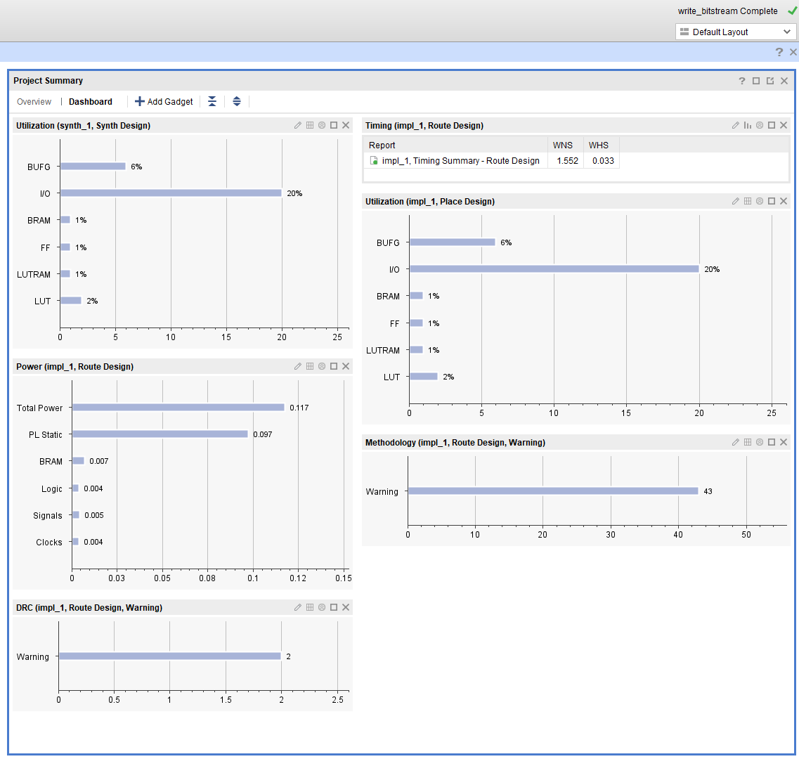
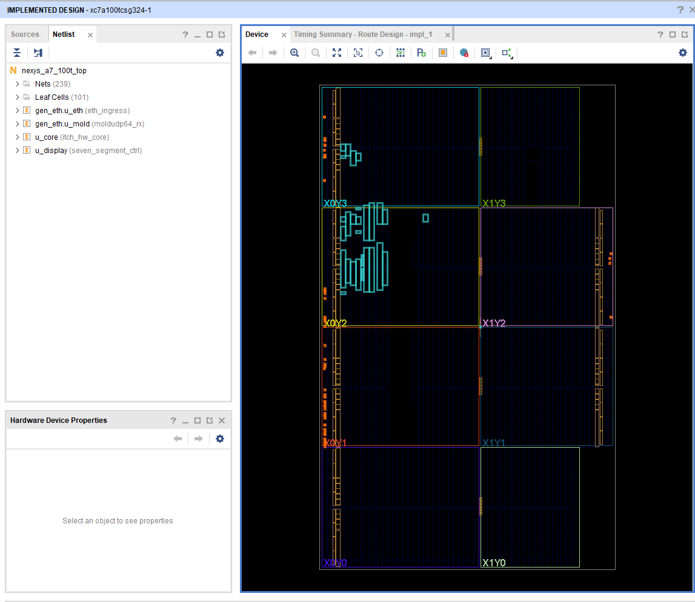

# Metrics


Numbers for **itch-hw** on the Nexys A7-100T — post-route Vivado results and cocotb functional latency.  
← [README](../README.md) · [architecture](architecture.md) · [board setup](board_eth_setup.md) · [build log](../log/2026-08-02%20-%20Successful%20Synthesis%20-%20Implementation%20-%20Bitstream.md)

---

## Contents

- [Build snapshot](#build-snapshot)
- [Timing](#timing)
- [Utilization & power](#utilization--power)
- [Functional latency](#functional-latency)
- [How to refresh](#how-to-refresh)

---

## Build snapshot

First clean end-to-end run with live Ethernet ingress (`USE_ETH=1`).

| | |
|---|---|
| **Date of build** | 2026-08-02 |
| **Toolchain used** | Vivado 2025.2 |
| **FPGA part** | `xc7a100tcsg324-1` |
| **Top module** | `nexys_a7_100t_top` |
| **Clock** | 100 MHz (`sys_clk_pin`) |
| **Runs** | `synth_1` ✓ · `impl_1` ✓ · `write_bitstream` ✓ |
| **Bitstream file** | `itch-hw.runs/impl_1/nexys_a7_100t_top.bit` |

**Timing constraints met** at 100 MHz — positive WNS/WHS, zero failed routes.

---

## Timing

Post-route summary (`impl_1`, routed).

| Metric | Target | Measured | Status |
|--------|--------|----------|--------|
| **WNS** | ≥ 0 ns | **+1.552 ns** | Met |
| **TNS** | 0 ns | **0.000 ns** | Met |
| **WHS** | ≥ 0 ns | **+0.033 ns** | Met |
| **THS** | 0 ns | **0.000 ns** | Met |
| **Failed routes** | 0 | **0** | Met |

<p align="center">
  
</p>

<p align="center"><em>Project summary — timing closed with headroom on Artix-7 100T</em></p>

---

## Utilization & power

Light footprint — plenty of room left on the 100T for deeper book logic or extra symbols.

| Resource | Used (approx.) | Available | % |
|----------|----------------|-----------|---|
| **Slice LUTs** | — | 63,400 | **2%** |
| **Slice FFs** | — | 126,800 | **1%** |
| **BRAM tiles** | — | 135 | **1%** |
| **LUTRAM** | — | — | **1%** |
| **DSP** | — | 240 | **0%** |
| **I/O** | — | — | **20%** |
| **BUFG** | — | 32 | **6%** |

| | |
|---|---|
| **Estimated total power** | **0.117 W** (Vivado post-route) |

<p align="center">
  
</p>

<p align="center"><em>Implemented hierarchy — RMII ingress → MoldUDP64 → ITCH core → display</em></p>

---

## Functional latency

Measured in **cocotb** @ 100 MHz against the Python golden model (`itch_hw_core` only — no Ethernet PHY in sim).  
Source: [`sim/results/latency_summary.json`](../sim/results/latency_summary.json) (regenerated by `sim/cocotb/run_tests.cmd`).

| Path | Budget | Measured (cycles) | Measured (ns @ 100 MHz) |
|------|--------|-------------------|-------------------------|
| Last ITCH byte → `record_valid` | ≤ 5 | **3** | **30** |
| `record_valid` → `bbo_valid` (Add) | ≤ 6 | **6** | **60** |
| `record_valid` → `bbo_valid` (Exec/Cancel at BBO) | — | ≤ 512 (rescan) | ≤ 5,120 |

On hardware, the README target remains **under 10 cycles** on the Add path for parse + BBO combined — sim and silicon should be reconciled after bench traffic.

---

## How to refresh

### Vivado (timing & utilization)

```text
vivado -mode batch -source vivado/build.tcl
```

Copy from `itch-hw.runs/impl_1/`:

- `*_timing_summary_routed.rpt` → WNS, TNS, WHS, THS
- `*_utilization_placed.rpt` → LUT, FF, BRAM counts
- `*_power_routed.rpt` → total power

Update the tables above and the badges at the top of this page.

### Simulation (latency)

```text
cd sim/cocotb
run_tests.cmd
```

Or on Linux / with GNU make:

```text
cd sim/cocotb && pip install -r ../requirements.txt && make
```

---

*Last updated from the 2026-08-02 build. Screenshots and narrative: [Successful Synthesis log](../log/2026-08-02%20-%20Successful%20Synthesis%20-%20Implementation%20-%20Bitstream.md).*
