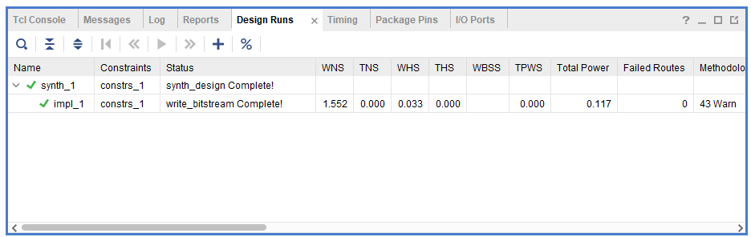
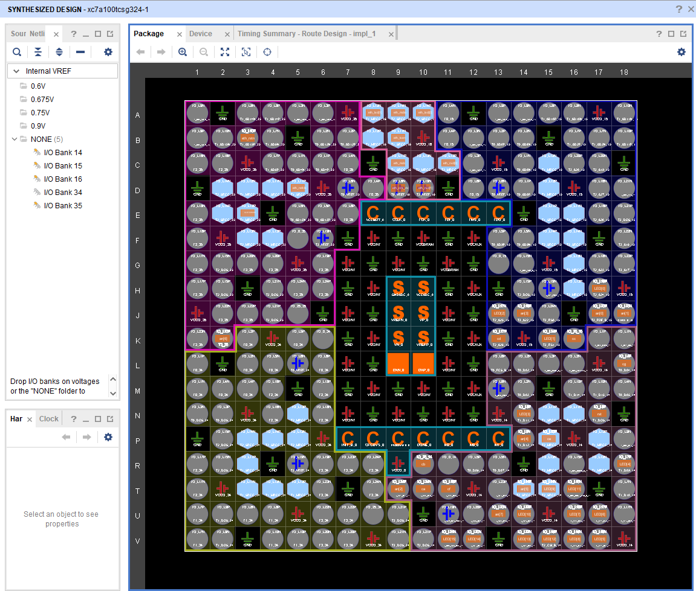
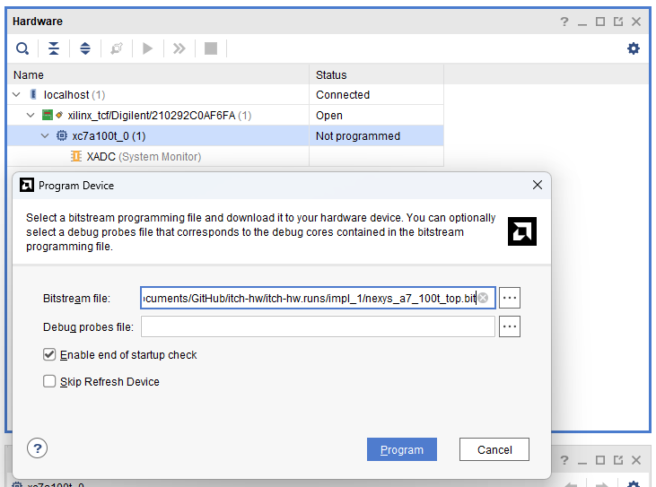

# First clean Vivado build — synthesis, implementation, bitstream

**Date:** 2026-08-02  
**Target:** Digilent Nexys A7-100T · `xc7a100tcsg324-1` · `USE_ETH=1`  
**Toolchain:** Vivado 2025.2

## Context

After several RTL iterations — Ethernet ingress, MoldUDP64 unwrap, streaming ITCH parser, dual-sided order book — the design finally closed timing and produced a bitstream. This is the first end-to-end Vivado run for the live UDP path (not just the cocotb core).

## Design runs

`synth_1` and `impl_1` both completed with green checkmarks. Post-route timing is clean:

| Metric | Value |
|--------|-------|
| WNS | **+1.552 ns** |
| TNS | 0.000 ns |
| WHS | **+0.033 ns** |
| THS | 0.000 ns |
| Failed routes | 0 |
| Total power (est.) | 0.117 W |

  

<em>Design Runs — synthesis and write_bitstream both complete</em>

## Project summary

Dashboard at a glance: timing closed, light utilization on the 100T fabric.

| Resource | Utilization |
|----------|-------------|
| I/O | 20% |
| BUFG | 6% |
| LUT | 2% |
| FF | 1% |
| BRAM | 1% |
| LUTRAM | 1% |

  

<em>Project summary — WNS +1.552 ns, WHS +0.033 ns, ~2% LUT</em>

## Synthesized design

Package view confirms RMII Ethernet pins (`eth_mdc`, `eth_mdio`, `eth_rxd`, `eth_crs_dv`, …) and status LEDs mapped to the Nexys A7 ballout.

  

<em>Synthesized design — package pins for Ethernet and LEDs</em>

## Implemented hierarchy

Post-route block diagram shows the full stack on silicon:

- `nexys_a7_100t_top`
  - `gen_eth.u_eth` → `eth_ingress` (RMII + UDP)
  - `gen_eth.u_mold` → `moldudp64_rx`
  - `u_core` → `itch_hw_core` (parser + order book + BBO)
  - `u_display` → `seven_segment_ctrl`

  

<em>Implemented design — full hierarchy placed on xc7a100t</em>

## Bitstream ready

Bitstream artifact: `itch-hw.runs/impl_1/nexys_a7_100t_top.bit`

Hardware Manager sees the Digilent JTAG target (`xc7a100t_0`) and is ready to program.

  

<em>Program Device — bitstream generated, board connected</em>

## What's next

Ethernet cable is on the bench. Next step: program the board, confirm **LED15** (link up), and inject Mold/ITCH test traffic with `tools/send_itch_udp.py.

As the problem domain becomes clearer, the decision logic will evolve. The goal is to let market-structure understanding drive the design, not FPGA friction — the fabric path is now proven.
